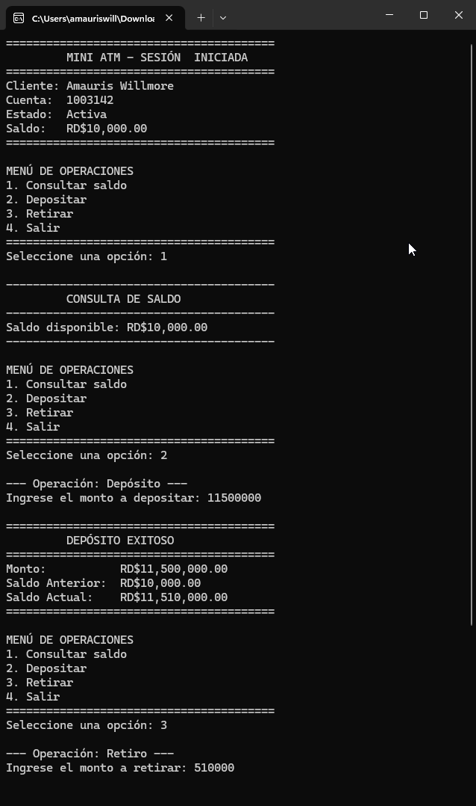
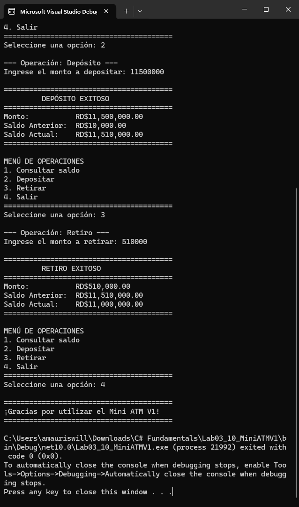

# Mini ATM V1 — Operaciones Iterativas y Validaciones

Prototipo de cajero automático en C# (.NET 10) que incorpora un menú interactivo con ciclo repetitivo para realizar múltiples operaciones consecutivas bajo la especificación BRD-ATM-3.10.

## Evidencia de Ejecución

